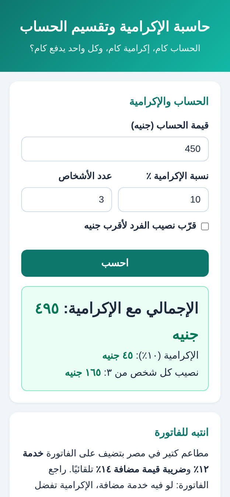

# Tip Calculator & Bill Splitter | حاسبة الإكرامية وتقسيم الحساب

Calculate the right tip and split the bill evenly between friends, with optional rounding to the nearest pound. Arabic interface.

**Live app:** https://abood-ayman.github.io/tip-calculator-ar/

**LinkedIn:** [Project entry](https://www.linkedin.com/in/abdullah-ayman-1678b737b/details/projects/)

This is a personal project, built with AI tools.

## Features
- Tip by any percentage you choose
- Split the total between any number of people
- Optional rounding of each person's share to the nearest pound
- Reminder to check the bill: many Egyptian restaurants already add 12% service and 14% VAT

## Privacy
Everything runs in your browser. No data is stored or sent anywhere.

## Run locally
Open `index.html` in any browser. It is a single static page with no dependencies.

## Status
Stable.

## Copyright
MIT License - Copyright (c) 2026 Abdullah Ayman.
